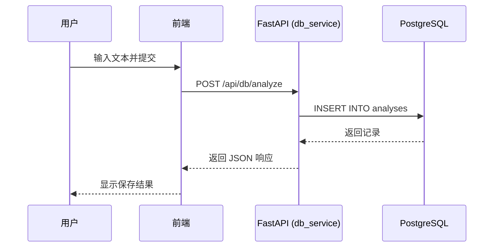
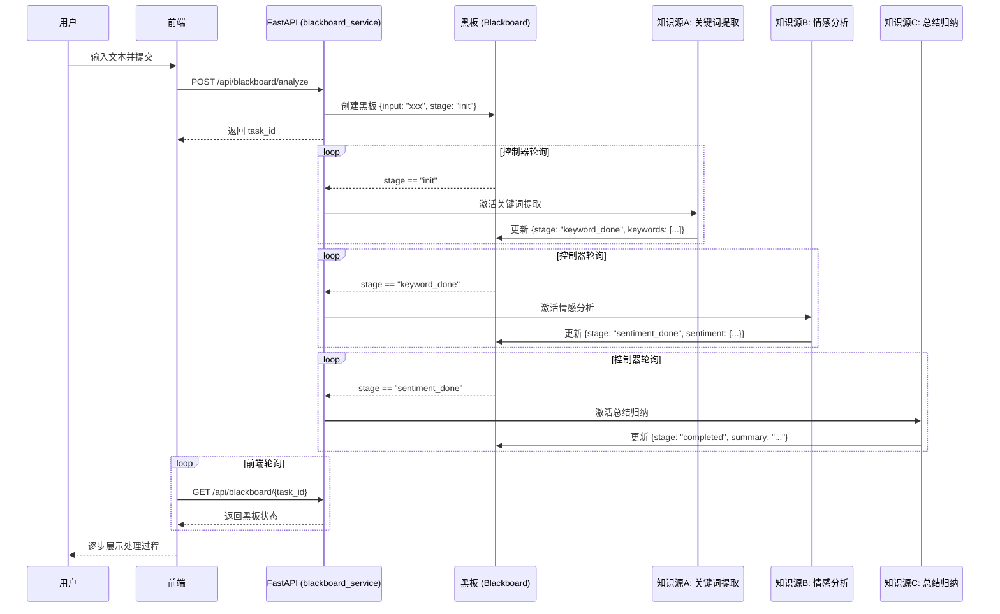

# Database vs Blackboard Architecture Demo

## 项目综述

本项目对比演示两种软件体系结构风格在处理"用户文本分析任务"时的差异：

| 维度 | 传统数据库风格 (Data-driven) | 黑板风格 (State-driven) |
|------|---------------------------|------------------------|
| **核心驱动** | 数据流驱动 — HTTP 请求直接触发 CRUD | 状态驱动 — 黑板状态变化触发知识源 |
| **处理方式** | 同步、顺序、确定性 | 异步、并行、非确定性 |
| **耦合度** | 各层紧耦合于数据模型 | 知识源松耦合，仅依赖黑板状态 |
| **适用场景** | 简单 CRUD、表单处理、报告生成 | AI 推理、信号处理、复杂决策 |
| **扩展性** | 需修改调用链 | 新增知识源即可扩展 |

### 为什么需要从 ini 文件升级为仓库系统

传统 `ini` 配置文件将配置与代码混杂，缺乏版本控制和类型安全。仓库系统 (Repository Pattern) 将数据访问封装为独立层：
- **单一数据源**：所有数据访问通过仓库接口
- **可测试性**：可轻松 mock 仓库层
- **可替换性**：PostgreSQL 可替换为 MongoDB、Redis 等
- **关注点分离**：业务逻辑与数据存储解耦

本 Demo 中，DB 风格展示了传统仓库模式，Blackboard 风格则展示了更高级的架构模式——数据不再是被动存储，而是主动驱动系统行为的"黑板"。

---

## 架构图

### 传统数据库风格（数据流驱动）



### 黑板风格（状态驱动）



---

## API 接口设计

### DB Service (端口 8001)

#### `POST /api/db/analyze`

**请求体：**
```json
{
  "content": "要分析的文本内容"
}
```

**响应：**
```json
{
  "id": 1,
  "content": "要分析的文本内容",
  "created_at": "2025-01-01T00:00:00"
}
```

#### `GET /api/db/history`

**响应：**
```json
[
  {
    "id": 1,
    "content": "要分析的文本内容",
    "created_at": "2025-01-01T00:00:00"
  }
]
```

#### `GET /api/db/{id}`

**响应：**
```json
{
  "id": 1,
  "content": "要分析的文本内容",
  "created_at": "2025-01-01T00:00:00"
}
```

---

### Blackboard Service (端口 8002)

#### `POST /api/blackboard/analyze`

**请求体：**
```json
{
  "content": "要分析的文本内容"
}
```

**响应：**
```json
{
  "task_id": "uuid-string",
  "status": "created"
}
```

#### `GET /api/blackboard/{task_id}`

**响应：**
```json
{
  "task_id": "uuid-string",
  "stage": "keyword_done",
  "input": "要分析的文本内容",
  "keywords": ["关键词1", "关键词2"],
  "sentiment": null,
  "summary": null,
  "created_at": "2025-01-01T00:00:00",
  "updated_at": "2025-01-01T00:00:01"
}
```

`stage` 可能的值：
- `init` — 初始状态
- `keyword_done` — 关键词提取完成
- `sentiment_done` — 情感分析完成
- `completed` — 全部处理完成
- `error` — 处理出错

#### `GET /api/blackboard/`

**响应：**
```json
{
  "tasks": [...],
  "count": 5
}
```

---

## 运行指南

### 前置条件
- Docker & Docker Compose 已安装

### 一键启动

```bash
# 克隆项目后进入目录
cd repository

# 启动所有服务
docker compose up --build

# 或后台运行
docker compose up --build -d
```

### 服务端口

| 服务 | 端口 | 说明 |
|------|------|------|
| Frontend | 9080 | 前端页面 |
| DB Service | 8001 | 传统数据库 API |
| Blackboard Service | 8002 | 黑板系统 API |
| PostgreSQL | 5432 | 数据库 |
| Redis | 6379 | 可选缓存 |

### 访问地址
- 前端页面: http://localhost:9080
- DB API 文档: http://localhost:8001/docs
- Blackboard API 文档: http://localhost:8002/docs

### 停止服务

```bash
docker compose down
docker compose down -v  # 同时删除数据卷
```

---

## 黑板架构优缺点

### 优点
1. **松耦合**：知识源之间无直接依赖，仅通过黑板通信
2. **可扩展**：新增知识源无需修改现有代码
3. **灵活性**：处理顺序由状态决定，非硬编码
4. **可解释性**：黑板状态可记录完整处理历史

### 缺点
1. **复杂性**：需要额外的控制器和状态管理
2. **性能开销**：轮询机制增加延迟
3. **调试困难**：状态变化可能产生难以追踪的副作用
4. **一致性挑战**：并发写入需要同步机制

### 在本 Demo 中的体现
- **优点体现**：三个知识源完全独立，可任意添加新阶段（如"情感增强"）而无需改动其他知识源
- **缺点体现**：轮询间隔引入 500ms 延迟；状态管理增加了代码复杂度；并发请求需要加锁保护
